<div align="center">

# Waste Heat to Hydrogen: Rankine Cycle + PEM Electrolyzer

**Thermodynamic modeling and performance evaluation of a hybrid Hydrogen Heat Recovery Energy System (HRES) in MATLAB/Simulink–Simscape**


-6E7681?style=flat-square)

*MSc Mechatronics Engineering · University of Rome "Tor Vergata"*

📄 **Full report:** [HRES_Rankine_PEM_Report.pdf](docs/HRES_Rankine_PEM_Report.pdf)

</div>

---

## Overview

Industrial exhaust gases carry a large amount of heat that is usually lost. This project models a system that turns this waste heat into **hydrogen**, using a **prototype-scale (small) organic Rankine cycle**:

**Waste heat → Mechanical power → Electrical power → Hydrogen**

1. A **heat recovery system** (economizer, evaporator, superheater) transfers heat from the exhaust gas to the working fluid of a **Rankine cycle**.
2. The superheated vapor expands in a **turbine** coupled to a **generator**, producing electricity; a **condenser** and a **liquid receiver** close the cycle.
3. The electricity that is not used by the load powers a **PEM electrolyzer**, which splits water into hydrogen and oxygen.
4. The hydrogen is stored in a **constant-volume tank**.
5. An **additional heat exchanger** reuses recovered heat to preheat the electrolyzer feedwater, reducing the power needed by the electric heater.

The whole system is modeled in a single **MATLAB/Simulink–Simscape** environment, combining thermal, two-phase fluid, mechanical, electrical and electrochemical domains.

> **Scale:** the model is a **prototype Rankine cycle** (up to about 11 kW electrical) supplying four households and a 30-cell PEM stack. It focuses on the thermodynamics and the control of the cycle; the same exhaust could feed a plant of about 150–180 kW at full scale.

<p align="center">
  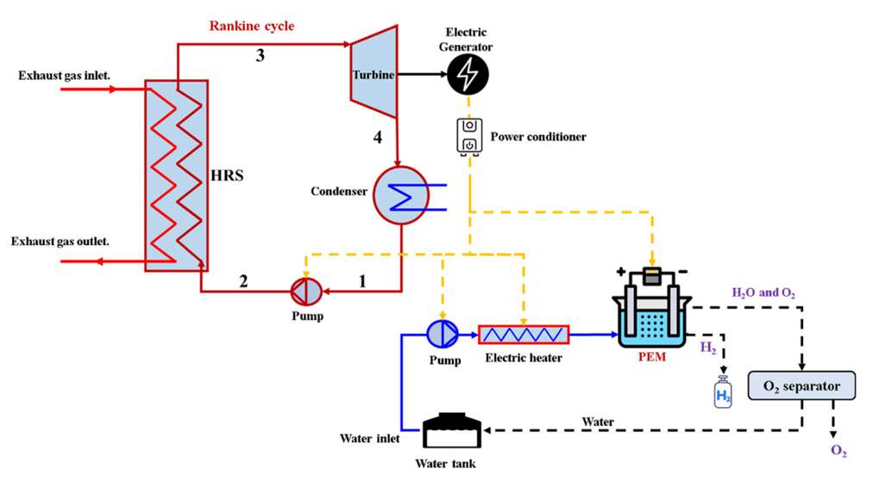
  <br><em>System layout: Rankine cycle with heat recovery, power conditioning, and PEM electrolyzer line</em>
</p>

---

## Background & Contribution

The project builds on the PEM configuration studied by **Nasser & Hassan**, *"Assessment of hydrogen production from waste heat using hybrid systems of Rankine cycle with proton exchange membrane/solid oxide electrolyzer"*, International Journal of Hydrogen Energy 48 (2023) 7135–7153 ([doi:10.1016/j.ijhydene.2022.11.187](https://doi.org/10.1016/j.ijhydene.2022.11.187)).

In that paper, the PEM system heats its feedwater **only with an electric heater** powered by the Rankine cycle; exhaust-gas preheating is used only in the SOEC system. The paper is also a steady-state analysis with a constant heat source. This project adds:

- **Exhaust-gas feedwater preheater for the PEM line:** a gas-to-water heat exchanger warms the electrolyzer water before the electric heater, so less of the generated electricity is spent on heating.
- **Dynamic (time-domain) model** in Simscape instead of a steady-state analysis, with turbine shaft dynamics, a variable electrical load, and a constant-volume H₂ storage tank.
- **Closed-loop control:** three PI loops on the ORC (shaft speed, evaporating pressure, superheat) and one on the electrolyzer water flow, plus a supervisory switch.
- **Realistic household demand:** load profiles of four households (LoadProfileGenerator, 15-min resolution) instead of a constant or fully-electrolyzer load.
- **Fluctuating waste-heat source:** in a real plant the exhaust is not constant; it follows the production schedule. Here the available exhaust flow is 5 kg/s on weekdays from 06:00 to 22:00 (full production) and drops to 3.5 kg/s at night and at the weekend (reduced production), with 15-minute ramps between the two levels. The ORC controllers adapt the exhaust used, the pump flow and the turbine nozzle so that the cycle keeps its pressure, superheat and shaft speed through these changes.

---

## Model Architecture

<p align="center">
  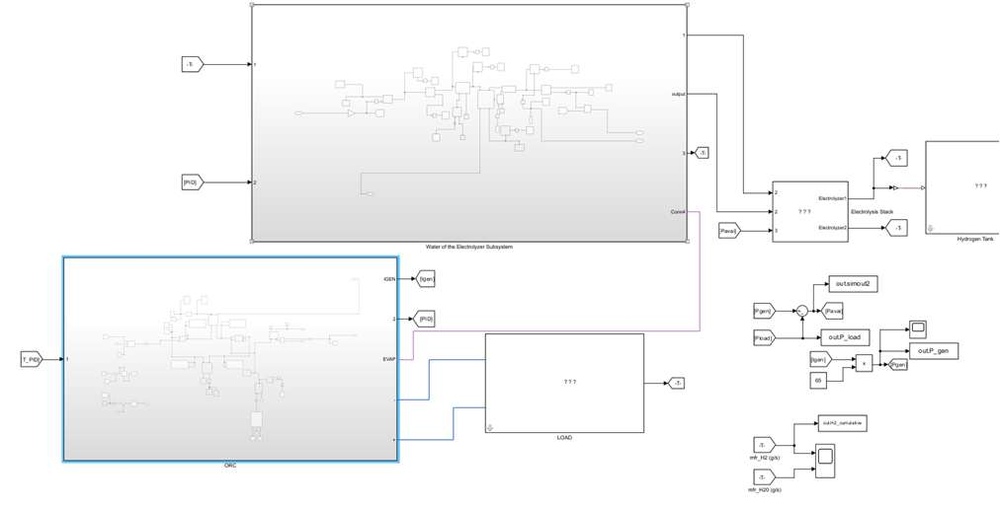
  <br><em>Top-level Simulink–Simscape model</em>
</p>

| Subsystem | What it models |
|---|---|
| **Heat source loop** | Exhaust gas supplying the recovered waste heat |
| **Heat Recovery System (HRS)** | Economizer, evaporator and superheater stages |
| **Rankine loop** | Pump → HRS → turbine → condenser → liquid receiver (two-phase R1233zd(E)) |
| **Turbine–generator** | Shaft dynamics (rotational inertia + load torque), mechanical → electrical conversion |
| **Electrical load** | Variable power demand connected to the generator output |
| **Feedwater preheater** | Extra heat exchanger that preheats the electrolyzer water |
| **Water conditioning** | Tank, circulation pump and controlled electric heater |
| **PEM electrolyzer** | Electrochemical stack: current → H₂ production and water consumption |
| **H₂ storage** | Constant-volume gas chamber; pressure rises as hydrogen accumulates |
| **Control** | ORC: speed, pressure and superheat PI loops; electrolyzer water-flow PI + supervisory switch |

<details>
<summary><b>Subsystem screenshots</b></summary>
<br>

| Rankine cycle | Electrolyzer water supply |
|---|---|
| 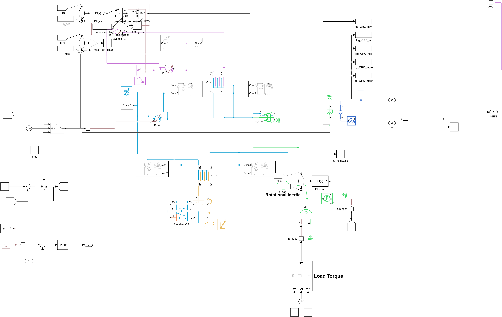 | 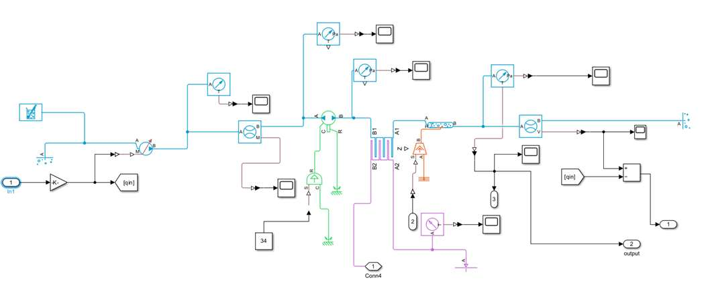 |

| PEM electrolyzer | Hydrogen storage |
|---|---|
| 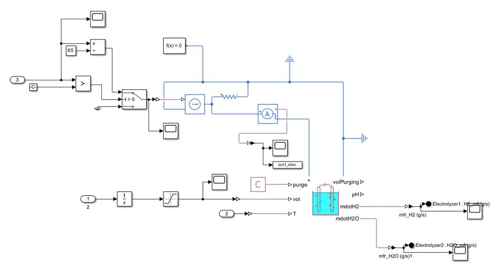 | 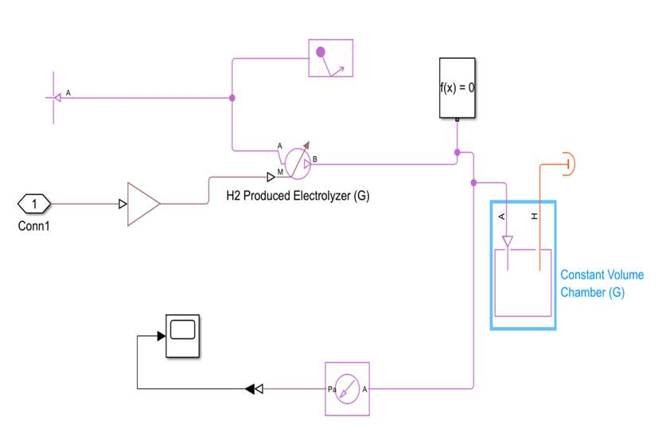 |

| Load model | Control strategy |
|---|---|
| 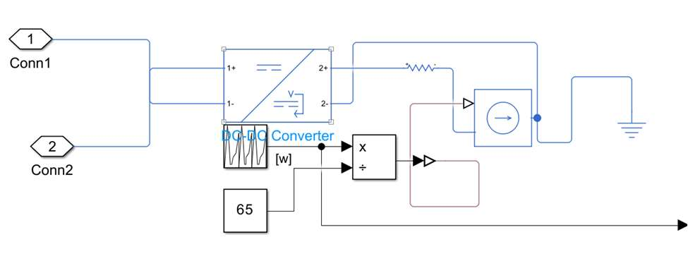 | 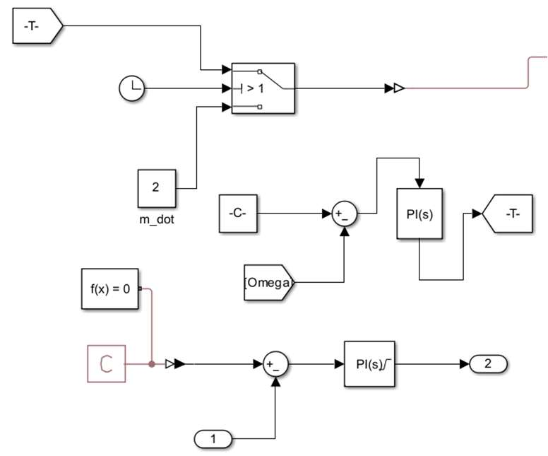 |

</details>

---

## Rankine Cycle (ORC) Design

The prototype ORC uses **R1233zd(E)** and recovers heat from an exhaust at 700 K. It is designed so that the turbine always receives superheated vapour and the pump always receives liquid:

| Component | Design |
|---|---|
| Heat-recovery exchanger (R1233zd(E) side) | 6 tubes × 12 mm × 10 m, parallel flow with the exhaust (small liquid hold-up, so the pressure responds quickly to the pump) |
| Condenser (R1233zd(E) side) | 20 tubes × 12 mm × 10 m, cooled by 15 kg/s of water at 293 K |
| Liquid receiver | 0.2 m³ after the condenser; the pump always draws liquid |
| Turbine | Variable nozzle; design point 0.6 kg/s, pressure ratio 6, inlet 1.0 MPa / 400 K; efficiency 0.8 |
| Exhaust bypass | Only the exhaust needed goes through the exchanger, with an over-temperature guard (410–430 K) |
| Shaft losses | 2 N·m (≈ 0.75 kW) for bearings and seals |

| Operating point (1-week mean) | Value |
|---|---|
| Evaporator / condenser pressure | 1.00 / 0.13 MPa (evaporator 0.999–1.001 MPa all week) |
| Turbine inlet | 400 K ± 0.2 K, superheated vapour (~27 K superheat) |
| Pump inlet | 298 K, liquid |
| Working-fluid flow | 0.05 kg/s mean, up to 0.28 kg/s (follows the demand) |
| **ORC efficiency** | **12.9 %** |

### Control strategy

- **Speed loop (PI):** moves the turbine nozzle so the shaft stays at 377 rad/s; the ORC produces exactly the power drawn by the load and the electrolyzer.
- **Pressure loop (PI):** sets the pump flow to keep the evaporator at 1.0 MPa (back-calculation anti-windup, so the pump never overshoots after running at its minimum flow).
- **Superheat loop (PI):** sets the exhaust flow through the heat-recovery exchanger to keep 400 K at the turbine inlet.
- **Electrolyzer controller (PI):** regulates the water flow sent to the PEM stack.

---

## Results

One-week simulation (Wednesday 1 April – Tuesday 7 April 2020) with a **residential load profile** from the LoadProfileGenerator dataset ([Pflugradt et al., 2022](https://doi.org/10.21105/joss.03574)): four households summed, 15-min resolution, scaled to the 7 kW peak load of the model. The week includes five working days and a weekend, so the waste-heat source changes between full and reduced production. Run with `run_simulation.m`:

<p align="center">
  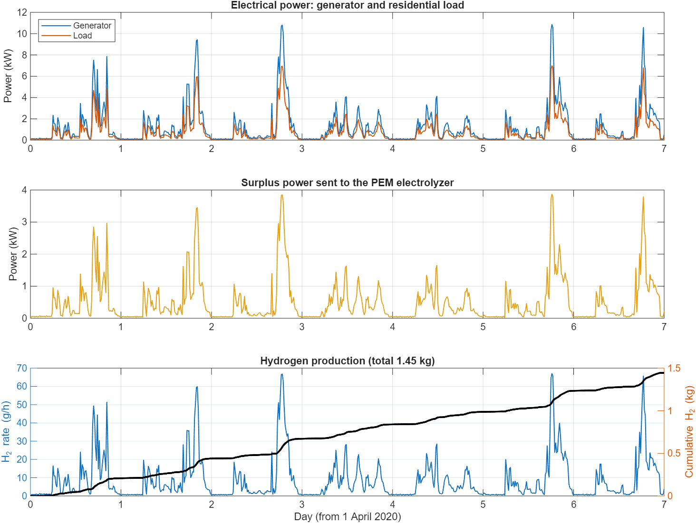
</p>

| Quantity | Result (1 week) |
|---|---|
| Generator output | 209.9 kWh (max 10.9 kW) |
| Electrical load | 125.9 kWh (max 7.0 kW) |
| To the electrolyzer | 84.1 kWh (max 59 A, 0.30 A/cm²) |
| Total H₂ produced | **1.445 kg** (Faraday's law: 1.445 kg) |
| H₂ per day | 0.147–0.248 kg (weekdays 0.226 kg on average, weekend 0.158 kg) |
| Specific energy consumption | **58.2 kWh/kg H₂** (typical PEM range: 50–60) |
| Electrolyzer efficiency | 57.3 % (LHV) / 67.7 % (HHV) |
| ORC efficiency | **12.9 %** |

The electrolyzer only uses the surplus power (generation − load), so hydrogen production follows the household demand pattern, with the largest output during the evening peaks and less hydrogen at the weekend. The simulated hydrogen matches the theoretical value from Faraday's law.

### ORC cycle

<p align="center">
  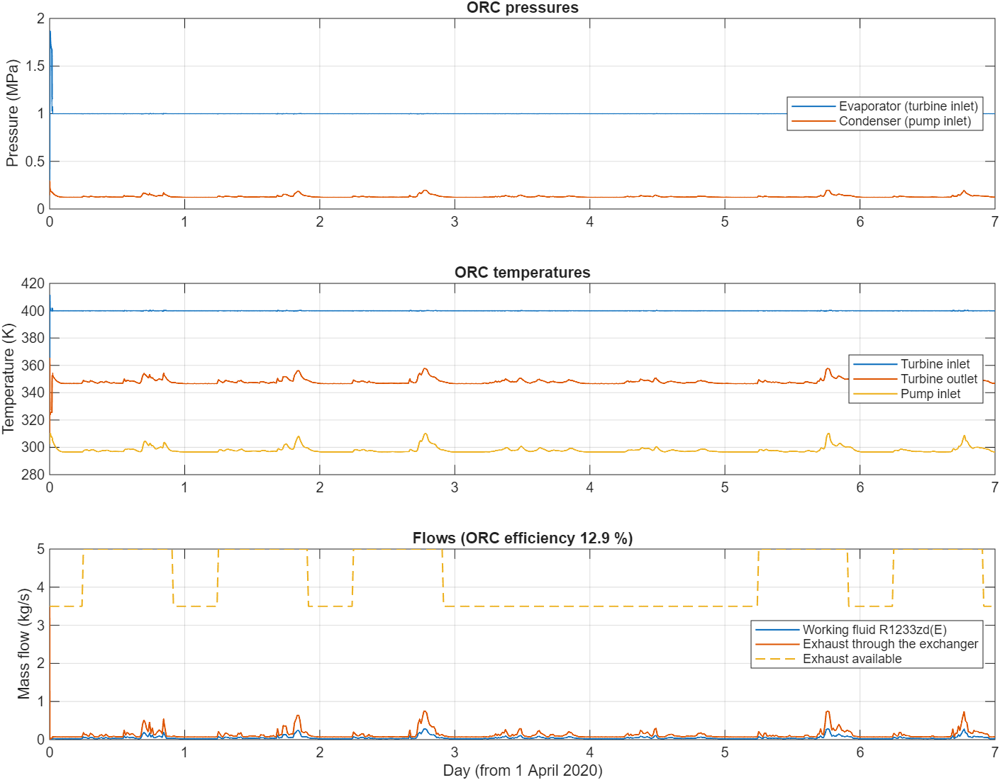
</p>

After the start-up (about 30 min), the evaporator pressure stays at **1.00 MPa** and the turbine inlet at **400 K** for the whole week: at night, during the evening peaks and when the waste-heat source changes between 5 and 3.5 kg/s. The condenser settles at 0.12–0.20 MPa (about 297–310 K, just above the cooling-water temperature). The turbine always receives superheated vapour and the pump always receives liquid; only the working-fluid and exhaust flows change, following the demand. The shaft speed stays between 376 and 377 rad/s.

### Energy fluxes

<p align="center">
  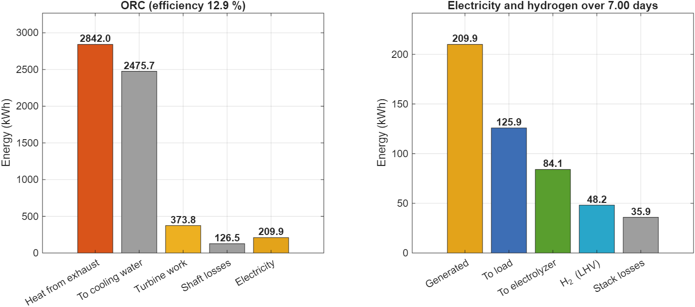
</p>

Over the week, the ORC absorbed **2842 kWh** of exhaust heat and rejected **2476 kWh** to the cooling water. The turbine produced **373.8 kWh**: 209.9 kWh became electricity and 126.5 kWh were bearing/seal losses (the rest is the turbine's mechanical efficiency). Of the electricity, 125.9 kWh (60 %) went to the load and 84.1 kWh (40 %) to the electrolyzer, which stored **48.2 kWh** as hydrogen (LHV).

---

## Limitations

- **Assumed values:** heat-exchanger geometry, turbine design point, shaft losses (2 N·m), exhaust schedule and controller gains are design assumptions, not data from a specific machine.
- **Prototype scale:** the cycle is a small ORC (about 11 kW electrical at most), not a full-size plant. It uses only about 3 % of the available exhaust because the electrical demand is small (four households and one 30-cell stack); at full scale the same exhaust could supply about 150–180 kW.

---

## Repository Structure

```
├── matlab/
│   ├── run_simulation.m   # single script: load and exhaust profiles, simulation, results, figures
│   ├── HRES_ORC_PEM.slx   # Simulink–Simscape model (design values stored in the model workspace)
│   └── data/              # LoadProfileGenerator data, 4 households, April 2020
├── figures/               # Diagrams, model screenshots and results
├── docs/
│   └── HRES_Rankine_PEM_Report.pdf   # Project report: modelling, control strategy and results
└── README.md
```

## How to Run

1. Open MATLAB (tested with R2025b) with **Simulink**, **Simscape**, **Simscape Fluids** and **Simscape Electrical**.
2. Set `matlab/` as the current folder.
3. Run **`run_simulation.m`**. It simulates **one week** (about 15–20 minutes of computing time), prints the electrical, hydrogen and ORC results, saves `results.mat` and the figures.

Change `n_days` and `start_hour` at the top of the script to simulate another period (for example `n_days = 1;` for one day, about 3 minutes).

The Simscape solver reports some numerical messages during the run (small step sizes at sharp load changes). They do not stop the simulation or affect the energy balance; the script hides them and prints a short summary at the end.

---

## Future Work

- Off-design turbine efficiency map (the turbine efficiency is constant in the model)
- Full-scale plant sized for the whole exhaust, with grid connection and a larger electrolyzer

## Author

**Mohamed Boudaya** — MSc Mechatronics Engineering, University of Rome "Tor Vergata"

## License

© 2026 Mohamed Boudaya. All rights reserved. This repository is shared for portfolio purposes; please do not copy or reuse the code, model or report without permission.
